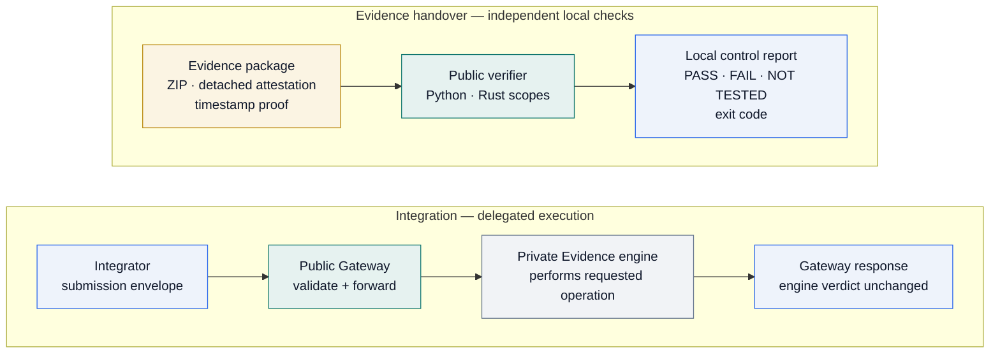
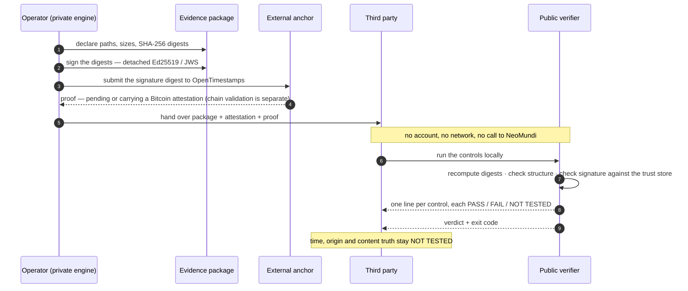
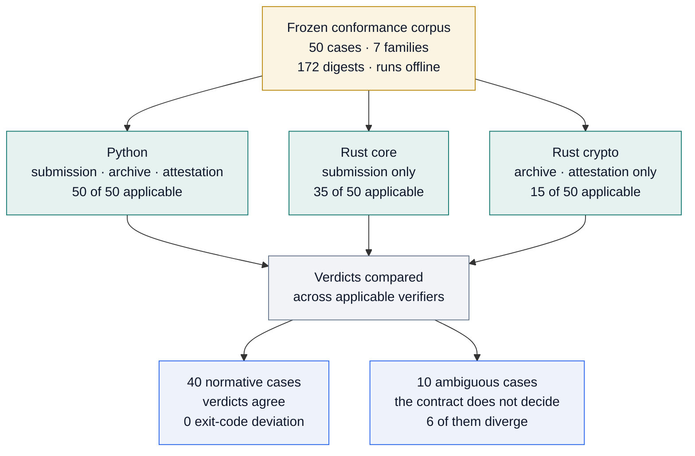

<div align="center">

<sub><b>English</b> · <a href="README.fr.md">Français — README</a></sub>

# NeoMundi Evidence — architecture

### Our product promise is grounded in its architecture.

**We expose the architecture so you can understand, inspect and challenge what the product
actually does.**

[Evidence](README.md) · [Public verifier](verifier/README.md) ·
[Specification](verifier/spec/SPECIFICATION.md) · [Conformance corpus](verifier/conformance/README.md) ·
[Limits](references/LIMITS.md) · [Reviews](references/REVIEWS.md)

</div>

---

**Reference document. 2026-11-17.** Every capability below carries its state and its limit.
Where this document and the code disagree, **the code wins** — this document is then wrong and
must be corrected.

> **Rule for anyone writing a README, a web page or a deck from this document:** a capability
> may be described as available only where this document marks it 🟢, and only inside the
> perimeter stated on the same line. Nothing marked 🟡 or 🔴 may appear in a present-tense
> sentence. See [§8](#8--messaging-and-documentation-rules).

| Indicator | Meaning |
|---|---|
| 🟢 | available **and demonstrated**, inside the perimeter named on the line |
| 🟡 | partial, experimental, or qualified only in part |
| 🔴 | not available, or not demonstrated |

**Four things are never conflated here**, because conflating them is how an evidence product
starts overclaiming: code that **exists**, a test that **passes locally**, something
**published**, and something **used in production by someone else**.

**How to check what you read.** Most of this document is checkable by anyone, right now, with
no account. Claims are labelled:

| Label | Means | Who can check |
|---|---|---|
| **Reproduced** | executed from this repository on 2026-11-17 while writing this document, on an ordinary workstation | anyone, offline, no account |
| **Published** | a file in this repository you can open | anyone |
| **Measured by NeoMundi** | a figure NeoMundi recorded, with its date and revision, in [`references/VERIFICATION_RESULTS.md`](references/VERIFICATION_RESULTS.md) | the operator — **not** a third party |
| **Private** | a file in the Evidence engine repository, named by path and never quoted | holders of granted access |

---

## 1 · Product promise

### Your AI produced an output. Can you prove what happened?

A customer disputes a result. An auditor asks which records support a claim. An incident has to
be reconstructed six months later. In each case the honest answer is usually a screenshot, a log
line, and a dashboard the other party is being asked to trust — and whoever keeps those can
change them.

Evidence closes that gap in three movements:

**PRESERVE → VERIFY → DEMONSTRATE**

| | What it means | What backs it | What it does not mean |
|---|---|---|---|
| **PRESERVE** | an operation becomes a structured package whose bytes are declared: paths, sizes, SHA-256 digests, and what is deliberately **not** stated | the private engine produces the archive, signs a detached Ed25519/JWS attestation over its digests, and can request an OpenTimestamps proof | 🔴 preservation is not proof of origin. Nothing here establishes that the execution happened as described |
| **VERIFY** | anyone holding the package re-runs the controls themselves, offline, with no account and no call to NeoMundi | the public verifier — `pip install neomundi-evidence-verify`, Python standard library only, plus two Rust implementations and a frozen 50-case corpus | 🔴 a verdict of `0` means *no control failed*, and that **includes controls that could not be performed**. `NOT TESTED` is not success |
| **DEMONSTRATE** | the package, the instructions and the explicit status are handed over so a third party repeats the supported checks and reaches their own verdict | the specification, the corpus and the verifiers are published; the gateway republishes an engine verdict unchanged, inside a versioned envelope | 🔴 it does not make the verification *independent of us*. These are our verifiers on our corpus — see [§5](#5--independent-verification-architecture) |

### One sentence that governs the whole product

> **A SHA-256 digest is not a signature, and integrity is not truth.**

Integrity says a package is internally consistent. It says nothing about whether the content is
true, whether the signer is who they claim to be, or whether the archive is the original rather
than a careful rewrite. A package whose content was replaced **and whose digests were
recomputed** passes every internal check — and that is correct behaviour, not a defect. Corpus
family **F** freezes both halves of it: the rewrite is accepted, and the same rewrite confronted
with the **original** attestation is refused.

What distinguishes an original from a competent rewrite is an **external anchor** — a signature
over the original digests held elsewhere, a third-party timestamp, a digest published somewhere
the rewriter does not control.

### Who this is for — a market hypothesis, not a customer list

| Segment | The moment they need it | Status |
|---|---|---|
| **B2B AI software vendors** | an enterprise buyer's security or audit questionnaire asks what evidence exists | 🟡 **beachhead hypothesis**, not validated demand |
| **AI engineering and quality teams** | an output is contested and the team has to reconstruct which records were preserved and which checks ran | 🟡 hypothesis |
| **Technical audit leads** | they need to repeat a supplier's checks rather than accept a report | 🟡 hypothesis |
| **Teams assembling an evidence file** | technical artifacts have to support — never replace — the compliance work someone else does | 🟡 hypothesis |

These four are **hypotheses of market, not confirmed customers.** No customer count, revenue
figure or performance claim appears anywhere in this document, and none should be added to it.

### Where Evidence sits, and where it stops

**Measurement → Station → Evidence** — three products, three functions, and they do not overlap:

| | Function | Boundary |
|---|---|---|
| **[Measurement](https://github.com/neomundi-io/neomundi-runtime-measurement)** | produces the measurements | it qualifies a text; it knows nothing of archives or attestations |
| **[Station](https://github.com/neomundi-io/neomundi-station-public)** | organises campaigns, observations and their provenance; keeps the append-only ledger | its ledger chain is verified by **Station**, not here |
| **Evidence** | checks the technical properties of an evidence package, under the controls that apply to it | it decides no conformity, certifies nothing, and never says an AI answer was true |

🔴 **Evidence does not recompute the Station ledger chain, by design.** Reimplementing it here
would be a second implementation of the ledger rules, and the one that produced the archive would
still be the reference. `verify.py` reports that control as `NOT TESTED` and names the command
that does it — `station ledger verify` — rather than pretending to cover it. **Reproduced.**

---

## 2 · Functional architecture



**Reading the diagram.** These are **two distinct routes**, not one pipeline. Above,
the public Gateway delegates an operation to the private engine and republishes its returned
report without verifying the package itself. Below, a reviewer holds an evidence package and
runs public verification locally; the Gateway is **not** on that path. Grey denotes the private
engine, gold the transferred evidence, teal public interfaces and verifiers, and blue request
or result surfaces. The published specification and corpus support the verifier but are not
runtime steps or automatic checks of each submitted package.

### The six functions, and who performs each

| Function | Performed by | State |
|---|---|---|
| **Produce evidence** — assemble the package, declare paths, sizes and digests | private engine | 🔴 not publicly installable, and not vendored here |
| **Build the dossier** — bind artifacts, declare provenance, request a timestamp | private engine | 🔴 not exposed by the gateway |
| **Integration interface** — accept a submission, run an engine entry point, republish the result | Gateway, *this repository* | 🟢 published · 🟡 version `0.1.0`, never exercised by a third party |
| **Verify** — recompute digests, check structure, check signatures, read a timestamp proof | public verifier, on the reader's machine | 🟢 **Reproduced** — see [§5](#5--independent-verification-architecture) |
| **Produce a verdict** — one line per control, a verdict, an exit code | whichever engine ran the controls | 🟢 contract published in the specification §10 |
| **Hand over to a third party** — package + instructions + explicit status | the operator holding the package | 🟢 everything needed is public; 🔴 no third party has exercised the gateway envelopes |

### The boundary that defines the product

> **The gateway verifies nothing — and that is the point.**

It reads no archive, computes no digest, compares no manifest and derives no verdict. Every
control line, every count and the verdict itself come from the engine and are republished
unchanged. Each response says so in its own payload:

```json
"verdict": { "source": "evidence-engine", "computed_by_gateway": false }
```

This abstention is not a shortcut. A gateway that reimplemented verification would be a second
verifier with its own divergences — the exact failure mode the specification exists to avoid.
[`tests/test_no_verification_logic.py`](tests/test_no_verification_logic.py) fails if a
verification primitive ever appears in the product sources, **and** confronts the republished
verdict field by field with a direct engine call on the same artifact.

**Reproduced 2026-11-17:** 7 PASS, 0 FAIL, 0 NOT TESTED — including the confrontation test, which
reported **21 control lines identical, identical counts, identical exit code**, with the public
verifier standing in as the engine.

---

## 3 · Technical foundation

| Component | Responsibility | Source | Contract | Status |
|---|---|---|---|---|
| **Evidence engine** | produces and **signs**. Key generation, attestation, binding, timestamping, trust-store publication, pilot reconciliation adapters | **private** · engine repository | engine report contracts, carried verbatim under `engine_report` | 🔴 **not published, not installable, not vendored.** Access granted, not public |
| **Gateway** | validate a request envelope, locate the engine, run the requested entry point, republish the report with local paths redacted | **public** · [`gateway.py`](gateway.py), [`engine.py`](engine.py) | `neomundi.evidence.gateway.request/1` · `…response/1`, both **closed** (`additionalProperties: false`) | 🟢 published · 🟡 `0.1.0`, no third-party integration |
| **Archive verifier (Python)** | recompute digests, check structure, check declared absences, name what it could not test | **public** · [`verifier/verify.py`](verifier/verify.py) | specification §6, §10 | 🟢 **Reproduced** — stdlib only, no network |
| **Attestation verifier (Python)** | detached Ed25519/JWS over the archive digests, read through a trust store **and its policy** | **public** · [`verifier/verify_attestation.py`](verifier/verify_attestation.py) | specification §7, §8 | 🟢 **Reproduced** · needs `cryptography`; without it, `NOT TESTED`, never `PASS` |
| **Submission verifier (Python)** | verify a submission package (`submission/1` and `/2`) | **public** · [`verifier/adapters/ingest.py`](verifier/adapters/ingest.py) | `neomundi.evidence.submission/1`, `/2` | 🟢 **35 of the 50 corpus cases need it** |
| **Canonicalisation profile** | the restricted JCS profile the attestation verifier depends on | **public** · [`verifier/canonical.py`](verifier/canonical.py) | `neomundi-jcs-strings/1`, specification §5 | 🟢 published |
| **Timestamp verifier** | read an OpenTimestamps proof tree and separate four states that are routinely conflated | **public** · [`verifier/timestamp.py`](verifier/timestamp.py) | specification §11 | 🟢 **Reproduced** · needs the `[timestamps]` extra |
| **Rust core verifier** | a **second implementation**, submissions only. SHA-256, JSON, ZIP and DEFLATE written in-crate | **public** · [`verifier/verifier-rs/`](verifier/verifier-rs) | same specification | 🟢 published · **`Cargo.lock` holds exactly 1 entry** — the absence of dependencies is checkable **without compiling** |
| **Rust crypto verifier** | archives and attestations in Rust. **Ed25519 is not reimplemented** — it uses `ed25519-dalek`, `default-features = false`, so it cannot even mint a key | **public** · [`verifier/verifier-rs-crypto/`](verifier/verifier-rs-crypto) | same specification | 🟢 published · 🟡 **23 `Cargo.lock` entries**; a first build needs a crate registry |
| **Specification** | the normative rules: architecture, contracts, canonicalisation, integrity, signatures, trust, absences, verdicts, timestamping, reconciliation | **public** · [`verifier/spec/SPECIFICATION.md`](verifier/spec/SPECIFICATION.md) | `evidence-protocol/1`, revision `1.0.0-rc.1` | 🟡 **Candidate Specification, not a final standard** — 4 open normative questions |
| **Traceability file** | every normative rule, what tests it, and whether the implementations obey it | **public** · [`verifier/spec/traceability.json`](verifier/spec/traceability.json) | — | 🟢 **102 rules.** Coverage: 81 COVERED, 12 PARTIAL, **3 GAP**, 6 NOT TESTABLE. Implementations: 97 CONFORMING, 2 PARTIAL, **3 UNKNOWN** |
| **Conformance corpus** | 50 frozen cases in 7 families, with the expectation written **before any verifier ran** | **public** · [`verifier/conformance/`](verifier/conformance) | `neomundi.evidence.conformance-corpus/1`, `VERSION` 1.3.0 | 🟢 **Reproduced** — 121 fixtures, **172 / 172 digests OK** |
| **Public trust store** | the Ed25519 public keys, the declared identities, and the **policy** for reading them | **public** · [`trust/trust-store.json`](trust/trust-store.json) | `neomundi.evidence.trust-store/1` | 🟢 published byte for byte, `sha256 dac94e8a…`, 3038 bytes · 🔴 `legal_capacity_to_attest: experimental`, powers **not verified** |
| **pip package** | the six verifier files plus the CLI, installable in one command | **public** · [PyPI `neomundi-evidence-verify`](https://pypi.org/project/neomundi-evidence-verify/) | Apache-2.0, Python ≥ 3.11 | 🟢 **0.2.0 on the index** (2026-11-27, 111 588 B) · `0.1.0` remains, immutable, and 🔴 **cannot read a `station.export.campagne/4` archive** — a third party pinned to it must upgrade (EVPACK-001) · extras `[attestations]`, `[timestamps]`, `[all]` · no mandatory dependency |
| **Published JSON schemas** | the ten contracts the protocol defines | **private** · engine `schemas/` | all draft 2020-12, all closed | 🟡 **Measured by NeoMundi**: 10 files, 10 valid, 10 closed. Not reachable from this repository |
| **Limits, reviews, results** | what is not established, who reviewed what, what was measured against which revision | **public** · [`references/`](references) | — | 🟢 published, and part of the product rather than a disclaimer |

### Important dependencies, and what each one costs

| Dependency | Who needs it | Cost of not having it |
|---|---|---|
| none | `verify.py`, `adapters/ingest.py`, `canonical.py`, `gateway.py`, `verifier-rs` | — these run on the standard library, or on nothing at all |
| `cryptography` | the Python attestation verifier | signature controls report `NOT TESTED`, never `PASS`. The corpus marks the nine attestation cases `NOT RUNNABLE` and exits **2** |
| `opentimestamps` | the Python timestamp verifier | the proof's **state** is unknown — but the **binding** to the subject digest is still checked |
| `ed25519-dalek` | `verifier-rs-crypto` only | that crate does not build offline on a first run. `verifier-rs` is unaffected, and the split exists for exactly this reason |
| `jsonschema` | the gateway's own suites | envelope validation against the published contracts reports `NOT TESTED`, never `PASS` |
| an engine installation | the gateway | exit code **3**, `engine_unavailable`, and **no verdict at all**. The gateway never reconstructs one from text output |

### Two structural facts worth knowing before reading further

**The public verifier is the engine's verification half, republished.** It is not a reduced
demonstration version: the files are a byte-for-byte republication of what the engine holds, and
[`tests/test_corpus_public.py`](tests/test_corpus_public.py) checks it. One visible consequence is
left deliberately uncorrected: some republished files still carry links to the engine repository,
which is private. Editing a frozen republished artefact to tidy a link would cost the one property
that makes publishing it worthwhile. **Read such a link as naming where the file came from, not as
somewhere you can go.**

**The repository is deliberately mixed-licence.** Apache-2.0 covers the verifier and this gateway.
It does **not** cover `verifier/spec/`, `verifier/conformance/`, `verifier/examples/` or
`trust/trust-store.json`, which are published for verification and review with rights reserved.
[`NOTICE`](NOTICE) lists the split line by line, and names the open question: a conformance corpus
that may not be redistributed is awkward for a third party implementing the protocol. That
decision has not been taken.

---

## 4 · Evidence and verification flow



### The eight steps, and what each one actually establishes

| # | Step | Declared | Recomputed | Cryptographically verified | Not verifiable here |
|---|---|---|---|---|---|
| 1 | **source operation** | everything: what ran, when, with which model | — | — | 🔴 that the execution took place as described |
| 2 | **declarations and artifacts** | paths, sizes, digests, model identity — or a **declared absence** with its reason | — | — | 🔴 that a declared evaluator actually ran |
| 3 | **package assembly** | the manifest and the members it declares | — | — | — |
| 4 | **digests and canonicalisation** | — | 🟢 every digest recomputed over the delivered bytes; JSON canonicalised under a restricted JCS profile before signing | — | 🔴 nothing: a matching digest proves consistency, not history |
| 5 | **attestation** | the signer's declared identity and declared time | — | 🟢 Ed25519 over the verbatim JWS bytes, read through the trust store **and its policy** | 🔴 legal identity, legal capacity, and the declared time — no trusted clock is involved |
| 6 | **timestamp** | the calendars submitted to, and `pending` or `confirmed` | 🟢 the proof's binding to the subject digest | 🟡 a Bitcoin attestation is **read**, not validated | 🔴 **verified time** — validating a chain attestation needs a block header, a trust source this tool does not have. Delegated to `ots verify` |
| 7 | **verdict and exit code** | — | 🟢 derived from the control lines in the same report | — | 🔴 a verdict is about the **package**, never about the event |
| 8 | **hand over and re-verify** | — | 🟢 a third party repeats every supported control offline | — | 🔴 that the design is right — see [§5](#5--independent-verification-architecture) |

### Verdicts, control states and exit codes

Three vocabularies, and the specification forbids collapsing any of them.

| Verdict | Meaning |
|---|---|
| **ACCEPTED** | every applicable control ran and passed |
| **REFUSED** | at least one control failed |
| **INCOMPLETE** | nothing failed, but something required to conclude was absent — *the question has not been answered* |

| Control state | Meaning |
|---|---|
| `PASS` | the control ran and the property holds |
| `FAIL` | the control ran and the property does not hold |
| `NOT TESTED` | the control did not run, and the report says why |

| Exit code | Verifier | Gateway | Did a verification happen? |
|---|---|---|---|
| **0** | no control failed | the engine ran, no control failed | yes |
| **1** | at least one control **failed** | same | yes |
| **2** | strict mode: a **required** guarantee is not demonstrated | same | yes |
| **3** | the verifier could not run | **engine unavailable** | **no** |
| **4** | bad usage — missing file or option | **request refused** | **no** |

🔴 **`0` is not a certificate.** It means *no control failed*, and that includes controls that
could not be performed. `--strict` turns an unmet **required** guarantee into `2`, and it changes
**no verdict line and no control state** — only the code. The specification states that as a rule:
the same evidence does not become more or less valid because a caller passed a flag.

**Reproduced 2026-11-17**, on the public corpus, offline:

| What was run | Observed |
|---|---|
| valid archive `A-05` | 17 PASS, 0 FAIL, 4 NOT TESTED — exit **0** |
| tampered archive `D-10` (one ZIP member rewritten) | 16 PASS, **1 FAIL**, 4 NOT TESTED — exit **1** |
| attestation `A-07`, no trust store supplied | 6 PASS, 0 FAIL, 5 NOT TESTED — exit **0**, *"no level reached beyond integrity"* |
| the same, with `--strict` | exit **2**, naming the two undemonstrated required guarantees: *cryptographic signature* and *trusted identity* |
| gateway, valid artifact | `completed`, engine verdict `no_failure` (17/0/4) — exit **0** |
| gateway, tampered artifact | `completed`, engine verdict `fail` (16/1/4) — exit **1** |
| gateway, engine root absent | `engine_unavailable`, **no verdict** — exit **3** |
| gateway, artifact path outside the root | `rejected`, **no verdict** — exit **4** |

The `A-07` pair is the product in one example: **four different situations return `0` by default**,
and only `--strict` separates *demonstrated* from *not testable*.

### The four states of a timestamp, never conflated

| Observed | Reported | Under `--strict` |
|---|---|---|
| a **Bitcoin** attestation is present | `PASS` — Bitcoin attestation identified in the proof, with block number(s); **the chain is not independently validated here** | `0` |
| only **PENDING** attestations | `NOT TESTED` — a calendar undertook to include the digest in a future transaction; **it attests no date** | **`2`** |
| the proof commits to another digest | **`FAIL`** — the binding is refuted | `1` |
| `opentimestamps` not installed | `NOT TESTED` — state unknown; the **binding** is still checked | `2` |

**Reproduced 2026-11-17** on the two proofs shipped in `verifier/examples/timestamp/`: the
confirmed one reports *2 Bitcoin attestations, blocks 974714 and 974715*; the pending one reports
*4 PENDING and no Bitcoin*. On **both**, the line *time verified by a third party* stays
`NOT TESTED`, and so does *eIDAS qualification* — which is declared **NONE**. OpenTimestamps is
not a qualified trust service provider under the regulation, and nothing here may be presented as
a qualified timestamp.

### What travels, and what is redacted

The gateway republishes the engine's report **verbatim except for paths**: the engine root, the
artifact root and the user's home directory are rewritten to `<engine>`, `<artifacts>` and
`<home>`, in string values only. Keys are never touched, and a digest cannot be — it contains no
path separator. The response says so in every payload (`engine_report_redacted`,
`redactions_applied`), so the republished report is **not** byte-identical to what the engine
wrote, and nobody has to discover that for themselves.

Every response also carries a non-empty `limits` array: the gateway's two own limits, plus every
`does_not_establish` line of the engine report, prefixed `engine:`. **Reproduced:** five entries
on a successful verification.

---

## 5 · Independent verification architecture

This section matters more than any other, because it is where an evidence product is most tempted
to overclaim.

### The ladder, and exactly which rung this product stands on

| # | Level | State | What is actually true |
|---|---|---|---|
| 1 | **Distinct implementations exist** | 🟢 | Python and Rust, two languages, different code. For the controls they both cover, a verdict is produced twice |
| 2 | **Concordance is checked** | 🟢 | the corpus runner compares verdicts across applicable verifiers, compares exit codes **separately**, and publishes disagreements as `ambiguous_divergences` instead of reconciling them |
| 3 | **A third party can reproduce the run** | 🟢 | anonymous clone, offline, no account, no key. **Reproduced 2026-11-17** |
| 4 | **Independent external review** | 🟡 | three external reviewers, each with a **bounded** scope; their observations were **reproduced by NeoMundi**, and reproduction by the author is not independent confirmation |
| 5 | **Complete independent validation** | 🔴 | **does not exist.** No third party has written a verifier, re-derived the specification, or validated the design |

> 🔴 **Two programming languages do not guarantee independent validation.** Stated here once, as
> a rule of the product: the sentence *"two implementations, therefore independently validated"*
> is forbidden, and [§8](#8--messaging-and-documentation-rules) repeats it.

### Why multiplicity is weaker than it looks here

Three distinct reasons, and none of them is a formality:

1. **All three verifiers were written by the same operator, from the same specification.** If the
   specification is wrong, they are wrong together. The corpus states this in its own limits: *two
   implementations that agree share the same residual error perimeter.*
2. **The two Rust crates are not two independent implementations of the primitives.**
   `verifier-rs-crypto` reaches **six modules of `verifier-rs` by `#[path]`** — SHA-256, JSON, ZIP,
   DEFLATE, path handling and the report. They are *the same files*, not a copy kept in step. The
   two crates differ in their **verification layer**, not in their primitives. **Published, and
   checkable in `verifier-rs-crypto/src/main.rs`.**
3. **The perimeters differ, so most cases are checked once, not twice.** Of 50 corpus cases, only
   a minority fall inside two verifiers at the same time.

### The three verifiers, and their real perimeters



**The denominators are the point.** A case outside a verifier's announced perimeter returns
`NOT APPLICABLE` — never `FAIL`. Blaming a tool for not doing what it never announced would be a
false measurement, and it would inflate the other tool's denominator. The matrix therefore
publishes **no conformance percentage at all**.

| Verifier | Covers | Applicable cases | Dependencies |
|---|---|---|---|
| **Python** | submission · archive · attestation | **50 / 50** | standard library; `cryptography` for the nine attestation cases |
| **`evidence-verify-rs`** | submission only | **35 / 50** | **none** — one `Cargo.lock` entry, builds offline with nothing |
| **`evidence-verify-crypto`** | archive · attestation only | **15 / 50** | `ed25519-dalek`, 23 locked packages; needs a registry on a first build |

### What the corpus reports, and who measured it

| Figure | Source |
|---|---|
| `sha256sum --check SHA256SUMS` → **172 / 172 OK** | 🟢 **Reproduced 2026-11-17** |
| Python verifier → **40 PASS, 10 AMBIGUOUS, 0 FAIL**, 0 exit-code deviation on a concordant verdict | 🟢 **Reproduced 2026-11-17** |
| `evidence-verify-rs` → 27 PASS, 8 AMBIGUOUS, 15 n/a | 🟡 **Measured by NeoMundi**, clean room, 2026-11-14 |
| `evidence-verify-crypto` → 13 PASS, 2 AMBIGUOUS, 35 n/a | 🟡 **Measured by NeoMundi**, clean room, 2026-11-14 |
| all three together → **80 PASS, 20 AMBIGUOUS, 50 n/a**, 0 exit-code deviation | 🟡 **Measured by NeoMundi** |

### Eight states, and the three that are routinely misread

| State | Meaning |
|---|---|
| `PASS` | the observed behaviour is what the case sheet expects |
| `FAIL` | it contradicts it — a regression |
| `KNOWN FAIL` | a **declared** defect, listed in `known_failures.json` and visible on every run |
| `NOT TESTED` | the control was not executed by this verifier |
| `NOT APPLICABLE` | the case does not address this verifier |
| `NOT RUNNABLE` | it **does**, but the **machine** lacks a prerequisite |
| `AMBIGUOUS` | the contract does not allow a single result to be imposed |
| `ERROR` | a technical error prevents any conclusion |

- **An expected refusal is a `PASS`.** Families B through E are mostly expected refusals. Counting
  them as failures would produce a conformance rate that rewards permissiveness.
- **`NOT APPLICABLE` is not `NOT RUNNABLE`.** The first says the verifier does not announce the
  subject; the second says it does, and the machine lacks a prerequisite. Today there is exactly
  one such prerequisite — `cryptography`, for the nine attestation cases on the Python verifier.
  The bench announces it **before any result**, marks those cases `NOT RUNNABLE`, and exits `2`.
- **`AMBIGUOUS` is a state of the bench, not a protocol verdict.** No verifier ever returns
  "ambiguous". It is the report refusing to decide where the contract is silent.

### Ambiguity is published, not smoothed

Ten of the fifty cases are ambiguous, and **six of them produce two honest verdicts on one file**.
That is the dangerous thing a normative silence produces, and the corpus names it: the runner
compares verdicts across applicable verifiers and reports `ambiguous_divergences` in a dedicated
section and in the matrix's *Divergent?* column. Until corpus 1.1.0 the runner measured each
verdict and never compared them, so one disagreement was in the data and invisible everywhere.
**A divergence the case sheets do not declare now turns CI red.**

This is also why the specification is a **Candidate** and not a final standard: four normative
questions are open — duplicate JSON object keys, `NaN` and `Infinity`, base64url strictness, and
path handling — and on each one the reference implementations are **measured as disagreeing** on
at least one case.

### Independent reviews — what three people actually did

| Reviewer | Scope reviewed | What changed | Attribution |
|---|---|---|---|
| **Mark Mocnaj** — Project Petunia × Judicator (OGS) | interoperability and ingestion of a third-party submission | **four ingestion discrepancies**, each a real adapter defect; the adapter stopped re-implementing schema rules by hand. **No published schema was modified** | 🟢 approved |
| **Dennis Christie** — ASIN-HHC / CP8 | reproducibility and execution evidence | a reported **AI measurement** and the underlying **external tool execution** were not being distinguished clearly enough; and **three declared contract fields were dead** — their prose stated a rule no code enforced. Falsified on real material: a declared length of 999 999 bytes on a 1 416-byte file returned `VERIFIED`, and now returns `CONTRADICTORY` | 🟢 approved |
| **A third external reviewer** | the conformance corpus and strict mode | two observations, both reproduced to the line. Investigating them uncovered a separate defect: the harness appended `--strict` to only **five of its seven** command paths, so three wrong expected values could not surface and CI stayed green on a claim it was not testing | 🟡 **pending the reviewer's approval of their name and wording.** Not named here, and not presented as approved |

🔴 **What a review is not.** Not a certification, not an endorsement, not a partnership claim. Each
review establishes what it examined, inside the scope it examined — and the per-review limits are
part of the attribution rather than a disclaimer appended to it. Corrective code authorship is
NeoMundi's, and is distinct from the reviewer contributions.

### Reproducible with no NeoMundi account, and offline — confirmed

🟢 Everything in the **Reproduced** rows of this document was run on 2026-11-17 on an ordinary
workstation from this repository alone: no NeoMundi account, no API key, no network call at
verification time, and no access to the private engine. That is the property the public
verification surface exists to provide, and it is the one thing a reader does not have to take on
trust.

🔴 **And it is still bounded.** Running our verifiers on our corpus confirms that our tools behave
as we describe. It does **not** establish that the design is right. The corpus is **frozen**:
evidence about the cases it contains, silent about every case it does not.

---

## 6 · Business outcomes

**Pain → capability → verifiable element → benefit → limit.**

| Pain | Capability | Verifiable element | Benefit | Limit |
|---|---|---|---|---|
| "A customer disputes a result and it is our word against theirs" | preserved package + published verifier | they run `neomundi-evidence verify` themselves, offline, with no account | the discussion moves from *trust our dashboard* to *run the check* | 🔴 it establishes the record's consistency, **not** that the AI output was right |
| "We have to reconstruct an incident months later" | declared paths, sizes, digests, and **declared absences with their reason** | a `NOT TESTED` line names what was missing and what would make it runnable | what was preserved and what was not is legible, instead of inferred | 🔴 a declared evaluator is **declared**; nothing here proves it ran |
| "We do not know whether an archive has been altered" | digest recomputation over the delivered bytes | exit **1** and the line naming the member that failed — **Reproduced** on `D-10` | tampering surfaces as a named failure, not a silent pass | 🔴 a **coherent rewrite** — content replaced *and* digests recomputed — passes. Only an external anchor defeats it |
| "An auditor wants to repeat the checks, not read our report" | frozen corpus + specification + three verifiers | `sha256sum --check SHA256SUMS` → 172/172, then the corpus runner — **Reproduced** | the auditor reaches their own verdict on their own machine | 🔴 our verifiers, our corpus. Reproduction is not independent validation |
| "A supplier must hand a technical file to a third-party organisation" | package + attestation + timestamp proof + explicit status | the trust store is published byte for byte; the attestation verifies against it | a transferable file instead of a claim | 🔴 the signer's `legal_capacity_to_attest` is **`experimental`**, and its powers are **not verified** |
| "We need the date to be provable" | OpenTimestamps proof, four states never conflated | a proof carrying Bitcoin attestations names their block(s) — **Reproduced**, without validating the chain | a `pending` proof is never represented as a verified date | 🔴 **verified time stays `NOT TESTED`**: validating a chain attestation needs a block header. No eIDAS qualification is claimed |
| "We want to plug this into our own pipeline" | gateway envelopes, closed contracts, five exit codes | codes 0/1/3/4 — **Reproduced**; `computed_by_gateway: false` in every payload | an integration boundary that cannot silently become a second verifier | 🟡 version `0.1.0`, **never exercised by a third party** |
| "We need a compliance certificate" | — | — | — | 🔴 **do not sell.** Evidence certifies nothing and decides no conformity |

### What this means for each audience

**AI software vendors** 🟡 — the strongest asset available today is that a buyer's engineer can
install the verifier in one command and check your package without an account. The limit to state
in the same breath: it checks the record, not the claim.

**Engineering and quality teams** 🟢 — the vocabulary is the deliverable. `PASS`, `FAIL` and
`NOT TESTED` are contract terms that must not be translated or collapsed, and `NOT TESTED` never
counts toward a coverage figure without being published as its own number.

**Technical audit leads** 🟢 — the specification is written to be sufficient on its own: a third
party implementing it should not need to read `verify.py`. The three `GAP` rules and the three
`UNKNOWN` ones are declared rather than hidden.

**Teams assembling an evidence file** 🟡 — these are genuine technical inputs to a file someone
else assembles. They are not the file, and no article-level coverage of any regulation is claimed.

### Services — opportunities, not shipped features

🟡 Everything in this list is a **commercial hypothesis**. None of it is delivered software, and
none may be described as a product capability: pilot onboarding and package design; building a
sector-specific evidence file with a customer; an independent verifier written by a third party;
operating an anchor outside NeoMundi's control; training an audit team to read the verdicts. Naming
them as opportunities is legitimate. Presenting them as available is not.

---

## 7 · Demonstration reference journey

Three tiers, because what you can do depends on what you have.

### Tier 1 — public, no account, offline

Every step below was run on 2026-11-17 and returned exactly what is shown.

| Step | Command | Observed |
|---|---|---|
| **1 · Install** | `pip install neomundi-evidence-verify` | `0.2.0` on the index, Apache-2.0, **no dependency pulled**. ⚠ Pin `>=0.2.0`: `0.1.0` cannot read a `station.export.campagne/4` archive (EVPACK-001) |
| **2 · Ask what this install can do** | `neomundi-evidence doctor` | what is installed, what is missing, and what each absence costs |
| **3 · Get the corpus** | `git clone https://github.com/neomundi-io/neomundi-evidence-gateway` | the corpus is **not** in the wheel — it lives here |
| **4 · Check the corpus is intact** | `cd verifier/conformance && sha256sum --check SHA256SUMS` | **172 / 172 OK** |
| **5 · Verify a valid archive** | `neomundi-evidence verify verifier/conformance/fixtures/A-valid/A-05-archive-valid/archive.zip` | 17 PASS, 0 FAIL, 4 NOT TESTED — exit **0** |
| **6 · Verify a tampered archive** | the same command on `D-tampered/D-10-archive-member-tampered/archive.zip` | 16 PASS, **1 FAIL**, 4 NOT TESTED — exit **1**, and the line names the member |
| **7 · Meet the trap strict mode exists for** | `verify_attestation.py …/A-07…/attestation.jws --archive …/archive.zip`, then the same with `--strict` | exit **0**, then exit **2** naming *cryptographic signature* and *trusted identity*. **Control lines byte-identical** between the two runs |
| **8 · Run the whole corpus** | `python3 runners/run.py --verifier python` | **40 PASS, 10 AMBIGUOUS**, 0 exit-code deviation |
| **9 · Read a timestamp proof** | `pip install "neomundi-evidence-verify[timestamps]"`, then `neomundi-evidence timestamp …confirmed.ots --subject …jws` | 4 PASS, 0 FAIL, 3 NOT TESTED — *2 Bitcoin attestations, blocks 974714 and 974715*, and **time verified by a third party stays `NOT TESTED`** |

**Step 7 is the one to show a sceptic.** Four different situations return `0` by default; only
`--strict` separates *demonstrated* from *not testable*, and it does so **without changing a single
verdict line**.

🟡 The two Rust verifiers are built with `cargo build --release` from `verifier/verifier-rs/` and
`verifier/verifier-rs-crypto/`, then passed to the runner with `--verifier all`. Their figures in
[§5](#5--independent-verification-architecture) are **Measured by NeoMundi** — no Rust toolchain
was available while writing this document, so they were not reproduced here. The claim that
`verifier-rs` has no dependency is checkable **without compiling**: its `Cargo.lock` holds one
entry.

### Tier 2 — gateway integration

| Step | Command | Observed |
|---|---|---|
| **1 · Point the gateway at an engine** | `export EVIDENCE_ENGINE_HOME=…` | 🟢 the **public verifier** can stand in as the engine — that is how the steps below were run |
| **2 · Submit an envelope** | `python gateway.py submit examples/02-verify-corpus-strict.json --artifact-root … --out response.json` | a `…gateway.response/1` envelope |
| **3 · A valid artifact** | `python gateway.py verify <archive.zip> --artifact-root …` | `completed`, engine verdict `no_failure` (17/0/4) — exit **0** |
| **4 · A tampered artifact** | the same, on `D-10` | `completed`, engine verdict `fail` (16/1/4) — exit **1** |
| **5 · No engine** | the same, with an absent engine root | `engine_unavailable`, **no verdict** — exit **3** |
| **6 · A path outside the root** | an `artifact.path` that escapes `--artifact-root` | `rejected`, `artifact_not_found`, **no verdict** — exit **4** |
| **7 · Check the abstention** | `python tests/test_no_verification_logic.py` | 7 PASS, 0 FAIL, 0 NOT TESTED — including **21 control lines identical** to a direct engine call |

**Read `exit_code` and `status`.** A `status` of `completed` does not mean the artifact passed — it
means the engine ran. Codes `3` and `4` exist so that *nothing failed* and *nothing ran* never
return the same value.

### Tier 3 — the full chain, which depends on the private engine

🔴 **The Evidence engine is not publicly installable, and nothing in this repository makes it so.**
Producing a package, binding artifacts, signing an attestation, requesting a timestamp and
publishing a trust store all live in the private engine. The gateway exposes **two** of its twelve
documented operations — `verify` and `attestation`. Binding, signing, timestamping, third-party
package ingestion and reconciliation are **named as future work** in
[`docs/INTERFACE.md`](docs/INTERFACE.md), not omitted silently.

A full-chain demonstration therefore runs under NeoMundi's operation, on an authorised dossier,
and must be presented as such. 🔴 It is **not** an independent third-party verification: the
gateway and the engine run under the same operator unless that operator states otherwise, and every
gateway response repeats it in its `limits` array.

---

## 8 · Messaging and documentation rules

These rules govern this repository, both READMEs, the website, sales material, investor decks,
demonstrations and developer documentation.

### Forbidden, with the correct form beside it

| 🔴 Never write | 🟢 Write instead | Why, and where it is grounded |
|---|---|---|
| "Evidence proves an AI answer is true." | "Evidence checks the technical record. It does not establish that the underlying AI response was true." | integrity is not truth — specification §15, corpus limit 1 |
| "Evidence certifies AI compliance." | "Evidence produces technical artifacts that may support compliance work done by others. It certifies nothing and decides no conformity." | specification §15; `references/LIMITS.md` |
| "Every record is independently validated." | "Every published figure can be re-measured by a third party from this repository, offline. No third party has validated the design." | §5, rung 5 is 🔴 |
| "All verification checks always pass." | "A verdict of `0` means no control failed — including controls that could not be performed. `NOT TESTED` is not success." | specification §9.1, EP1-ABS-001 |
| "Two programming languages guarantee independent validation." | "Python and Rust are two implementations written by the same operator from the same specification. The two Rust crates share six primitive modules. Their agreement rules out some defects, not a common one." | §5; `verifier-rs-crypto/src/main.rs` |
| "Every AI action is cryptographically linked to its measurement." | "An attestation commits a key to specific digests. The link between an external execution and a separate AI measurement is **declared**, not cryptographically bound." | `references/REVIEWS.md`, Dennis Christie's recorded limit |

### Fifteen rules

1. **Never write that Evidence certifies, proves compliance or validates an AI answer.** It checks
   a technical record.
2. **Never present a digest as a signature.** A SHA-256 digest establishes internal consistency.
   An Ed25519 signature commits a key to bytes. Neither establishes an identity.
3. **Never present a signature as an identity.** The four guarantees — *bytes as declared*,
   *signature valid*, *key trusted*, *signer is who they claim* — must stay separate, and the
   fourth is established by **nothing in this protocol**.
4. **Never present `0` as a certificate**, and never report `PASS` for a control that did not run.
5. **Never count `NOT TESTED` toward a coverage or success figure** without publishing it as its
   own number.
6. **Never present a `pending` timestamp as an attested date**, and never claim an eIDAS qualified
   timestamp. OpenTimestamps is not a qualified trust service provider.
7. **Never say time is verified.** Validating a chain attestation needs a block header; that check
   is delegated to the official client.
8. **Never present a coherent rewrite as detectable.** A package whose content was replaced and
   whose digests were recomputed passes — by design. Say what defeats it: an external anchor.
9. **Never present a report produced through the gateway as an independent third-party
   verification.** The gateway and the engine run under the same operator unless that operator
   states otherwise.
10. **Never quote a conformance rate.** The matrix publishes none, because a rate computed over a
    partial corpus reads as a rate over the protocol. Quote counts with their denominator, and name
    the verifier.
11. **Never quote a detection rate without naming its battery**, and never present an expected
    refusal as a failure.
12. **Never present the specification as a standard.** It is a **Candidate Specification** with four
    open normative questions.
13. **Never present a reproduction by NeoMundi as independent confirmation**, and never present a
    pending attribution as approved.
14. **Never attribute to Evidence what only Measurement, Station or a third-party system can
    establish** — a measurement's value, a ledger chain's integrity, or that an external action
    occurred.
15. **Never use a README as evidence.** Cite a schema, the specification, a corpus case, a
    reference document, a test, a commit or an executed command.

### Vocabulary

| Use | Not |
|---|---|
| evidence package · archive | proof, certificate |
| control state — `PASS` / `FAIL` / `NOT TESTED` | passed / failed, green / red |
| verdict — ACCEPTED / REFUSED / INCOMPLETE | valid / invalid |
| integrity | authenticity, truth |
| attestation | certification |
| declared | verified, established, proven |
| recomputed | checked |
| external anchor | timestamp, date |
| trusted key | trusted signer |
| reproduced by a third party | independently validated |
| experimental legal capacity | legally binding |
| bounded review | audit, certification |

### The three sentences that may always be said

> **Preserve technical evidence. Verify its integrity. Share records others can check
> independently.**

> **A SHA-256 digest is not a signature, and integrity is not truth.** Evidence establishes what a
> record contains and whether it is internally consistent — never that the event described
> occurred.

> **Our product promise is grounded in its architecture. We expose the architecture so you can
> understand, inspect and challenge what the product actually does.**

---

<div align="center">

[Evidence](README.md) · [Public verifier](verifier/README.md) ·
[Specification](verifier/spec/SPECIFICATION.md) · [Conformance corpus](verifier/conformance/README.md) ·
[Limits](references/LIMITS.md) · [Reviews](references/REVIEWS.md) ·
[Results](references/VERIFICATION_RESULTS.md) · [Discuss a pilot](mailto:contact@neomundi.io)

*A capability described here as available is marked 🟢 and carries the evidence that makes it
checkable, inside the perimeter named on its line. Everything else carries its state.*

</div>
